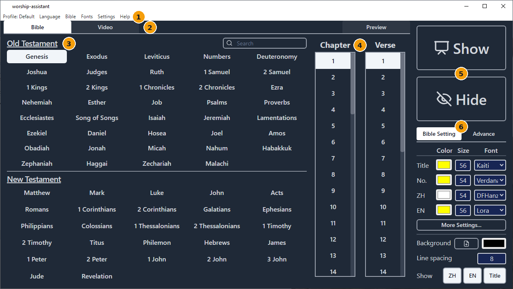
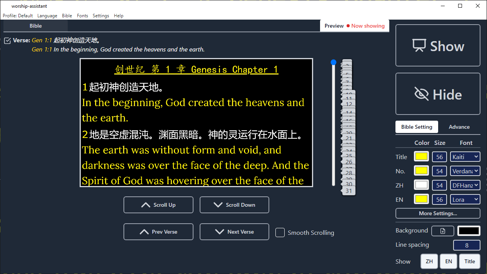
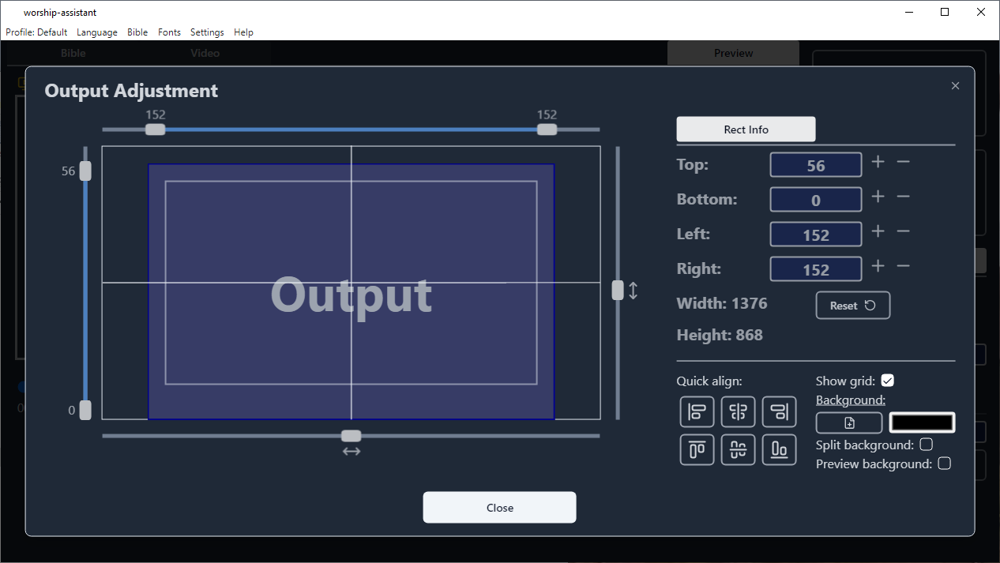
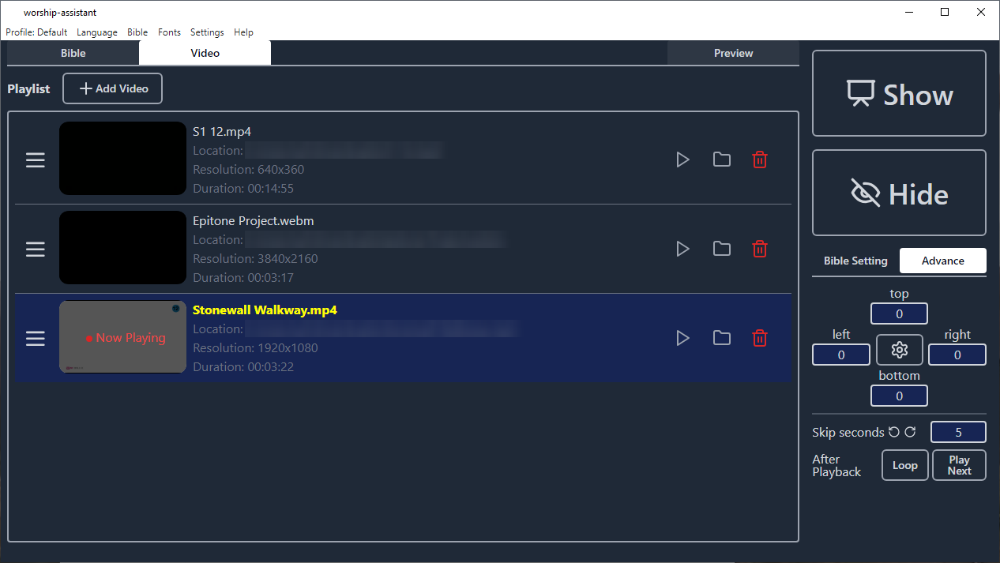
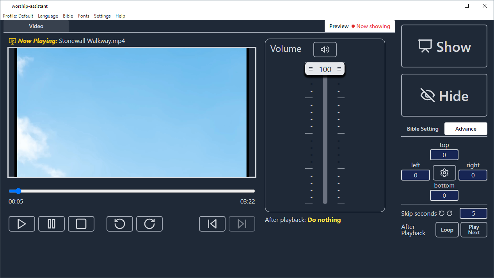
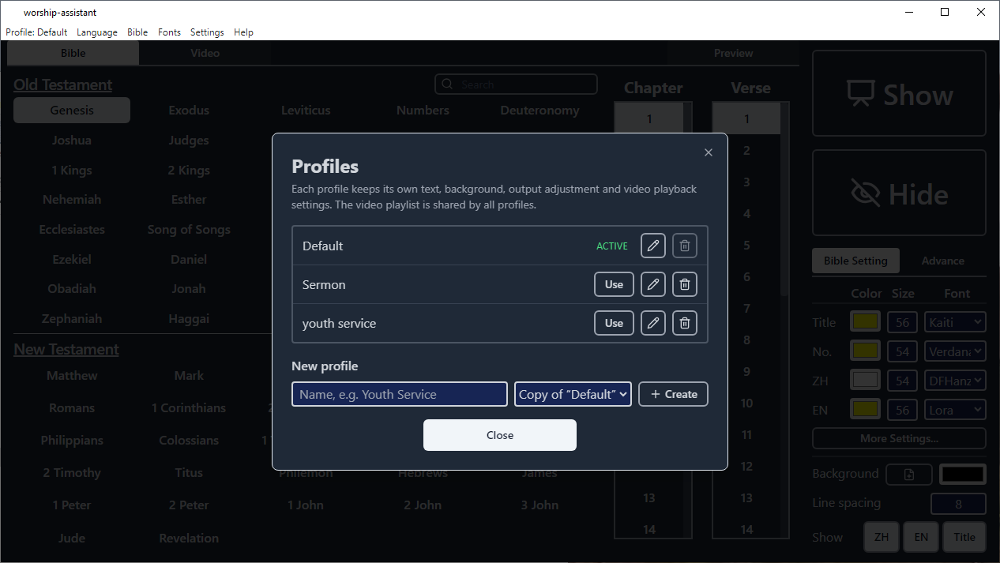

# Worship Assistant User Guide

中文版：[Worship Assistant 使用手册](user-guide.zh.md)

Worship Assistant shows Bible passages and videos on a projector or TV during a worship service. You control everything from your own screen, the **control panel**, while the congregation sees only the **output** on the second screen.

This guide has three parts:

- [Getting started](#getting-started) walks you through your first service.
- [Recipes](#recipes) are short step-by-step answers to common tasks.
- [Reference](#reference) lists the menus, shortcuts and file formats, and helps when something goes wrong.

You can open this guide any time from **Help › User Guide**, or by pressing **F1**.

## Getting started

### Install the app

1. Download the latest version and unzip it into a folder, for example in **Documents** or on the **Desktop**. Don't run it straight from inside the zip file, and avoid **Program Files**, because the app saves its settings in that folder.
2. Open the folder and double-click **Worship Assistant.exe**.

The app keeps its settings, Bible text files, fonts and background images in a folder called `data`, next to `Worship Assistant.exe`. Keep the two together.

### Connect the projector

Worship Assistant shows its output on the **second screen**: the first screen that isn't your main one.

1. Connect the projector or TV to the computer.
2. Press **Windows key + P** and choose **Extend**. Don't choose **Duplicate**, or the congregation will see your control panel too.
3. Start Worship Assistant. The control panel opens on your main screen.

If you plug the projector in after starting the app, the output moves to it by itself.

If you only have one screen, the output covers the whole screen when you show it. Press **Esc** to hide it again.

### Find your way around the control panel



1. **The menu bar**: profiles, Bible text, fonts, settings and help. **Profile** shows the name of the profile you're using.
2. **The tabs**:
   - **Bible**: pick a book, chapter and verse.
   - **Video**: your video playlist.
   - **Preview**: a live picture of what the congregation sees, with buttons to scroll the text or control the video.
3. **The books**, with a **Search** box to find one quickly.
4. **The chapters and verses** of the book you picked.
5. **Show** and **Hide**: put your choice on the screen, or take it off.
6. **The settings tabs**:
   - **Bible Setting**: text colours, sizes, fonts and the background.
   - **Advance**: the output position, scrolling and video playback options.

### Show your first passage

1. Click the **Bible** tab.
2. Click a book, for example **John**. To find one quickly, type part of its name in the **Search** box, in English or Chinese.
3. Click a number in the **Chapter** list, then in the **Verse** list.
4. Click **Show**.

The whole chapter appears on the output screen, starting at the verse you chose. The control panel switches to the **Preview** tab so you can see what's on the screen, and the tab shows a red **Now showing** sign.

> **Tip:** Choosing a different verse doesn't change the screen by itself. Make your choice, then click **Show** again. This lets you prepare the next passage without the congregation seeing you look for it.

### Hide the output

Click **Hide**. The projector goes back to showing nothing from Worship Assistant.

You can also press **Esc** while the output window is active. This is handy on a single screen, where the output covers the control panel.

### Close the app at the end

Close Worship Assistant normally with the **×** button. Your settings are saved when the app closes. If the computer is switched off without closing the app first, changes made since the app was started may be lost.

## Recipes

### Show a Bible passage during the sermon

1. Before the service, pick the book, chapter and verse on the **Bible** tab. Nothing appears on the screen yet.
2. When the passage is needed, click **Show**.
3. When the preacher moves on, click **Hide**, or pick the next passage and click **Show** again.

### Follow along as the passage is read

Once a passage is showing, use the **Preview** tab to move through the chapter. The line at the top shows the verse you chose, and the picture below it is what the congregation sees right now.



- **Next Verse** and **Prev Verse** jump one verse at a time.
- **Scroll Down** and **Scroll Up** move a fixed distance. Set how far under **Advance › Scroll unit**.
- Turn the **mouse wheel** over the preview picture to scroll gently.
- Drag the **slider** beside the preview, or click one of the **verse markers** next to it, to jump to a verse.
- Tick **Smooth Scrolling** to make the text glide instead of jumping.

### Show English and Chinese together

The app comes with the Chinese Union Version (和合本). To show English as well, first load an English Bible text (see [Load an English Bible translation](#load-an-english-bible-translation)). Then:

1. Open the **Bible Setting** tab.
2. Next to **Show**, make sure both **ZH** and **EN** are switched on.

Each verse then appears in Chinese with its English text underneath.

### Show only one language

On the **Bible Setting** tab, next to **Show**, switch off **ZH** or **EN**. Switch off **Title** to hide the book and chapter heading at the top of the screen.

### Load an English Bible translation

The app doesn't include an English translation, so you need to load one before showing English text.

1. Get a Bible text file for a translation you are allowed to use. Many modern translations are copyrighted and need permission from their publisher. Public domain English translations include the Berean Standard Bible (BSB), the World English Bible (WEB) and the King James Version (KJV).
2. Choose **Bible › Load English Bible Text…** and select the file.

The app tells you if any verses are missing or any book names aren't recognised. The file has to be in a particular layout, described under [Bible text file format](#bible-text-file-format).

You can also replace the built-in Chinese text with **Bible › Load Chinese Bible Text…**, and go back to it with **Bible › Use Built-in Chinese Text**.

### Make the text bigger or change its look

On the **Bible Setting** tab there is one row for each part of the text:

| Row | What it is |
| --- | --- |
| **Title** | The book and chapter heading, for example "约翰福音 第 3 章 John Chapter 3" |
| **No.** | The verse numbers |
| **ZH** | The Chinese verse text |
| **EN** | The English verse text |

Each row has a **Color**, a **Size** and a **Font**. If the output is showing, changes appear on the screen straight away, so you can adjust them while the congregation is reading.

For bold, italic and underline, click **More Settings…** on the same tab. That window also shows a preview of the text on your background.

To add more space between verses, raise **Line spacing**.

### Use your church's font

Besides the fonts installed on the computer, you can add your own font files (TrueType `.ttf` or OpenType `.otf`), for example a font your church uses or one downloaded from Google Fonts.

1. Choose **Fonts › Add Fonts…** and select one or more font files. To get bold and italic text in the font's own design, add its Bold and Italic files too.
2. Pick the font in the **Font** list next to a text setting. Added fonts are listed first.

The app copies the files into its `data` folder, so you can move or delete the originals afterwards.

To remove a font, choose **Fonts › Remove Font**. Text set to use it is shown in the default font instead. Fonts can't be removed while the output is showing.

If a font name in the list ends in **(not available)**, that font isn't on this computer, for example because the settings came from another computer. Add the font with **Fonts › Add Fonts…**, or pick a different one.

### Put a picture behind the text

1. On the **Bible Setting** tab, click the button next to **Background**.
2. Choose an image file.

The app copies the image into its `data` folder. To remove it, point at the small picture of the background and click the red **×**.

The colour box next to it sets the background colour, which shows when there is no image, or around an image that doesn't fill the screen.

### Fit the text inside the projector screen

Some projectors cut off the edges of the picture, or you may want to keep part of the screen clear, for example the bottom of the screen for the people at the back.

1. Open the **Advance** tab.
2. Enter how many pixels to leave empty at the **top**, **left**, **right** and **bottom** of the output.

For more control, click the **gear** button in the middle. The **Output Adjustment** window shows the whole screen, with the output area as a blue box inside it.



In this window you can:

- drag the two handles on the slider **above** the picture to set the left and right edges, and on the slider to the **left** of it to set the top and bottom edges
- drag the slider **below** the picture (↔) or to the **right** of it (↕) to move the whole box without changing its size
- type exact numbers, or use **+** and **−**, next to **Top**, **Bottom**, **Left** and **Right**. **Width** and **Height** show the size of the box, and **Reset** fills the whole screen again
- use the **Quick align** buttons to move it to the left, centre, right, top, middle or bottom
- tick **Show grid** to line it up
- tick **Split background** to place the background separately from the text, so the picture can fill the whole screen while the text stays in a smaller area
- tick **Preview background** to see your real background in the picture

### Play videos before the service

1. Click the **Video** tab.
2. Click **Add Video** and choose one or more video files. MP4 files work best.
3. Click the **play** icon (▷) on the video you want to start with. It is marked **Now Playing**.
4. Click **Show**. The video appears on the screen, paused at the start.
5. On the **Preview** tab, click **Play**.



Each video in the playlist shows its name, where it is on the computer, its size and how long it lasts. On the right are three icons:

- **▷ play**: choose this video
- **folder**: show the file on the computer
- **bin**: remove it from the playlist. The file itself is kept

To change the order, drag a video by the **≡** handle on its left.



Under the video on the **Preview** tab:

- the **timeline**: drag it to jump to any point
- the buttons, from left to right:
  - **Play**, **Pause**, and **Stop**, which goes back to the start
  - **skip back** and **skip forward** (the round arrows). Set how many seconds they skip under **Advance › Skip seconds**
  - **previous video** and **next video**, which are greyed out when there is no video before or after this one

On the right are the **Volume** slider and a mute button.

Clicking **Hide** pauses the video.

Videos are played from where they are on the computer, not copied into the app. Don't move or delete them before the service. If a video can't be found, it is removed from the playlist and the app tells you. If a video says **This video format is not supported**, convert it to MP4 first.

### Loop a video or a whole playlist

Open the **Advance** tab and choose what happens when a video ends, under **After Playback**:

| Loop | Play Next | What happens |
| --- | --- | --- |
| Off | Off | The video stops at the end |
| On | Off | The same video plays again |
| Off | On | The next video in the playlist starts |
| On | On | The whole playlist plays round and round |

The **Preview** tab shows the current choice under **After playback**.

### Switch from a Bible passage to a video

While a Bible passage is showing, the **Video** tab is hidden, and while a video is showing, the **Bible** tab is hidden. This stops you changing the wrong thing by mistake.

1. Click **Hide**.
2. Click the **Video** tab (or the **Bible** tab) and get it ready.
3. Click **Show**.

### Keep a separate setup for youth service

A **profile** is a set of settings: text styles, background, line spacing, output adjustment and video playback options (volume, loop, play next, skip seconds). Use profiles to keep separate setups, for example one for the main service and one for youth service. The video playlist is shared by all profiles.

1. Click **Hide** if the output is showing. Profiles can't be switched or created while the output is showing, because that would change what's on the screen.
2. Choose **Profile › Manage Profiles…** from the menu.
3. Under **New profile**, type a name, for example "Youth Service".
4. Choose whether it starts as a **copy** of the profile you're using, or with **Default settings**, then click **Create**.



To switch, choose the profile in the **Profile** menu, or click **Use** next to it in this window. The profile you're using is marked **Active**, and the menu title always shows its name. Any changes you make are saved to it.

Click the **pencil** to rename a profile, or the **bin** to delete it. You can't delete the profile you're using, so switch to another one first.

### Upgrade to a new version

Choose **Help › Check for Updates…** to see whether a newer version has been released. The app only checks when you choose this, and needs an internet connection. If there is a newer version, you can download it or read what changed.

1. Unzip the download into a **new** folder. Keep the old folder for now.
2. Run the new version.
3. Choose **Settings › Import from Previous Version…** and select the old version's folder.

Your profiles, background images, video playlist, loaded Bible text files and added fonts are copied across. Once you've checked everything works, you can delete the old folder.

### Back up your settings or move to another computer

Everything the app saves is in its `data` folder, next to `Worship Assistant.exe`. To find it, choose **Settings › Show Settings File in Folder**.

- **To back up**, close the app and copy the whole Worship Assistant folder somewhere safe, such as a USB stick.
- **To move to another computer**, copy the folder across, then follow [Upgrade to a new version](#upgrade-to-a-new-version), using the copied folder as the "previous version".

Videos aren't stored in the `data` folder, so copy them separately and add them to the playlist again. If you added your own fonts, they come across too. Fonts that were installed on the old computer need installing on the new one, or you can add them with **Fonts › Add Fonts…** instead.

### Report a problem

1. Choose **Help › About Worship Assistant**.
2. Click **Copy Details**. This copies the version number and the location of the `data` folder.
3. Paste the details into your message, and describe what you did and what went wrong.

## Reference

### Menus

| Menu | Item | What it does |
| --- | --- | --- |
| **Profile** | *(profile names)* | Switch to another profile |
| | **Manage Profiles…** | Create, rename or delete profiles |
| **Language** | **English (EN)** / **Mandarin (ZH)** | Show the book names on the **Bible** tab in English or Chinese |
| **Bible** | **Load English Bible Text…** | Load an English translation from a text file |
| | **Remove English Bible Text** | Remove the loaded English translation |
| | **Load Chinese Bible Text…** | Replace the built-in Chinese text with another one |
| | **Use Built-in Chinese Text** | Go back to the built-in Chinese Union Version |
| | **About Bible Text Files…** | Explain the layout a Bible text file needs |
| **Fonts** | **Add Fonts…** | Add `.ttf` or `.otf` font files |
| | **Remove Font** | Remove a font you added |
| **Settings** | **Import from Previous Version…** | Copy settings from another Worship Assistant folder |
| | **Show Settings File in Folder** | Open the `data` folder |
| **Help** | **User Guide** | Open this guide |
| | **Check for Updates…** | See whether a newer version is available |
| | **About Worship Assistant** | See which version you have, and copy details for a problem report |

### Keyboard and mouse

| Key or action | What it does |
| --- | --- |
| **F1** | Open this guide |
| **Esc** (on the output screen) | Hide the output |
| **Mouse wheel** over the preview | Scroll the text on the output screen |
| **Enter** / **Esc** when naming a profile | Save / cancel the name |

### Bible text file format

A Bible text file is a UTF-8 text file with one verse per line, written as `<book> <chapter>:<verse> <text>`. The book name can be separated from the reference by spaces or a tab:

```
Gen 1:1 In the beginning, God created the heavens and the earth.
Genesis 1:2	The earth was without form and void…
```

Books can be written as full English names (`Genesis`, `1 Samuel`), common abbreviations (`Gen`, `1Sam`, `Ps`, `Matt`) or Chinese names (`创世纪`, `创`). Lines that aren't verses, such as a title line, are skipped.

The app copies the file into its `data` folder, so you can move or delete the original afterwards.

### The data folder

The `data` folder sits next to `Worship Assistant.exe` and holds:

- `settings.json`: your profiles and video playlist
- the Bible text files you loaded
- the fonts you added
- your background images

Don't edit these files by hand. Use the app's menus instead.

### Troubleshooting

**The output appears on my own screen instead of the projector.**
Press **Windows key + P** and choose **Extend**. The output goes to the screen that isn't your main display. To change which screen is the main one, open Windows **Display settings**.

**The congregation can see my control panel.**
Windows is set to **Duplicate**. Press **Windows key + P** and choose **Extend**.

**The output covers my whole screen and I can't get back.**
Press **Esc**. This happens when only one screen is connected.

**I picked a new verse but the screen didn't change.**
Click **Show** again. The screen only changes when you click **Show**.

**The English text doesn't appear.**
Load an English translation with **Bible › Load English Bible Text…**, and check that **EN** is switched on next to **Show** on the **Bible Setting** tab. A yellow note on that tab tells you when a language is switched on but has no Bible text loaded.

**The edges of the text are cut off.**
Leave a margin around the output. See [Fit the text inside the projector screen](#fit-the-text-inside-the-projector-screen).

**A font says "(not available)".**
That font isn't on this computer. Add it with **Fonts › Add Fonts…**, or choose another.

**I can't switch profiles, load Bible text, import settings or remove a font.**
Click **Hide** first. These are blocked while the output is showing, so they don't change what the congregation sees.

**A video says "This video format is not supported".**
Convert the video to MP4 with a video converter, then add it again.

**A video disappeared from the playlist.**
The file was moved, renamed or deleted, or is on a USB stick that isn't plugged in. Add it again from its new place.

**My changes were lost.**
Settings are saved when the app closes. Always close Worship Assistant with the **×** button before switching the computer off.
