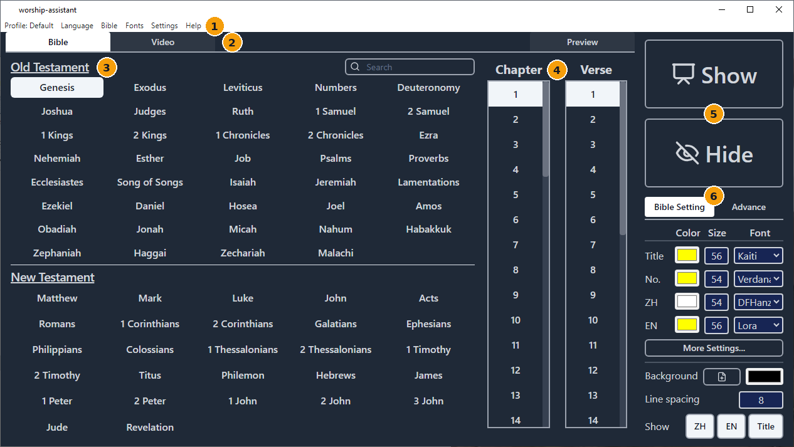
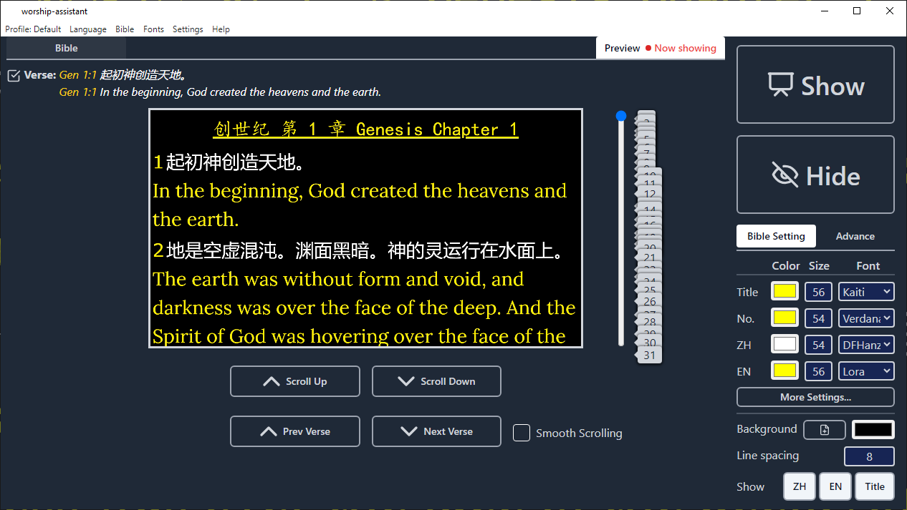
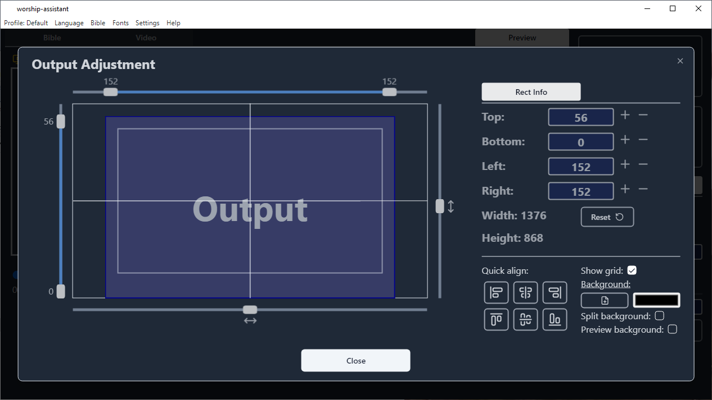
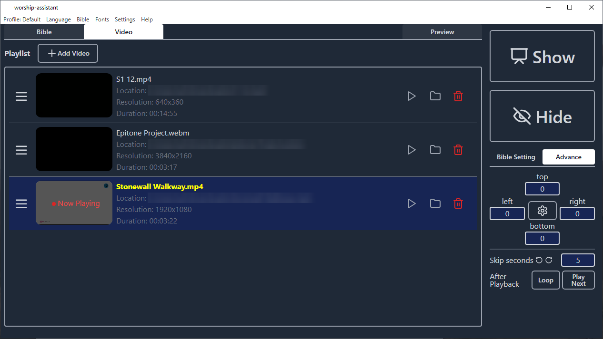
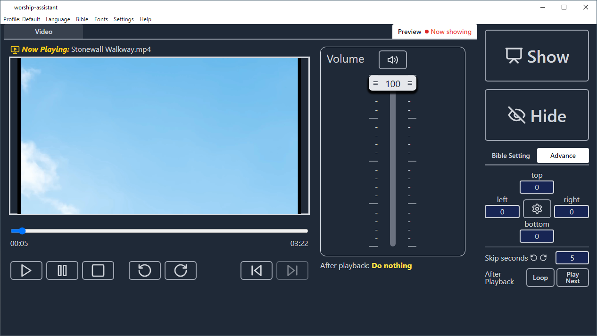
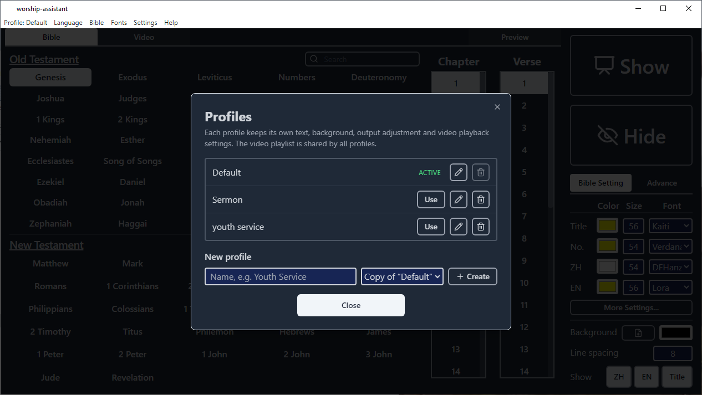

# Worship Assistant 使用手册

English version: [User Guide](user-guide.md)

Worship Assistant 用于在崇拜聚会中，把经文和视频显示在投影仪或电视上。你在自己的屏幕（**控制面板**）上操作，会众只会在第二个屏幕上看到**输出画面**。

本手册分为三部分：

- [入门](#入门)：带你完成第一次聚会的操作。
- [常用操作](#常用操作)：常见任务的简短步骤。
- [参考](#参考)：菜单、快捷键和文件格式，以及出问题时的解决办法。

程序的按钮和菜单都是英文的。本手册中以粗体显示的英文（例如 **Show**）就是你在屏幕上看到的文字，照着点即可。

随时可以从菜单 **Help › User Guide** 打开本手册，或按 **F1**。

## 入门

### 安装

1. 下载最新版本，解压到一个文件夹，例如 **文档** 或 **桌面**。不要直接在压缩包里运行，也不要放在 **Program Files**，因为程序会把设置保存在这个文件夹里。
2. 打开文件夹，双击 **Worship Assistant.exe**。

程序把设置、圣经文本文件、字体和背景图片保存在 `Worship Assistant.exe` 旁边一个名为 `data` 的文件夹里。两者要放在一起。

### 连接投影仪

Worship Assistant 会把输出画面显示在**第二个屏幕**上，也就是第一个不是主屏幕的屏幕。

1. 把投影仪或电视连接到电脑。
2. 按 **Windows 键 + P**，选择 **扩展**（Extend）。不要选 **复制**（Duplicate），否则会众也会看到你的控制面板。
3. 启动 Worship Assistant。控制面板会在你的主屏幕上打开。

如果在程序启动后才接上投影仪，输出画面会自动移过去。

如果只有一个屏幕，显示时输出画面会盖住整个屏幕。按 **Esc** 即可隐藏。

### 认识控制面板



1. **菜单栏**：配置、圣经文本、字体、设置和帮助。**Profile** 后面显示的是你正在使用的配置名称。
2. **选项卡**：
   - **Bible**：选择书卷、章和节。
   - **Video**：视频播放列表。
   - **Preview**：实时显示会众正在看到的画面，并有滚动经文或控制视频的按钮。
3. **书卷**，以及用来快速查找的 **Search** 搜索框。
4. 所选书卷的**章**（**Chapter**）和**节**（**Verse**）。
5. **Show**（显示）和 **Hide**（隐藏）：把你选好的内容显示到屏幕上，或撤下来。
6. **设置选项卡**：
   - **Bible Setting**：文字颜色、大小、字体和背景。
   - **Advance**：输出位置、滚动和视频播放选项。

书卷按钮默认显示英文名称。选择菜单 **Language › Mandarin (ZH)** 可以改为显示中文名称。

### 显示第一段经文

1. 点击 **Bible** 选项卡。
2. 点击一卷书，例如约翰福音（**John**）。要快速查找，可在 **Search** 框里输入书名的一部分，中英文都可以。
3. 在 **Chapter** 列表中点一个数字，再在 **Verse** 列表中点一个数字。
4. 点击 **Show**。

整章经文会显示在输出画面上，从你选的那一节开始。控制面板会切换到 **Preview** 选项卡，让你看到屏幕上显示的内容，选项卡上还会出现红色的 **Now showing**（正在显示）。

> **提示：** 选择另一节经文并不会自动改变屏幕上的内容。选好后要再点一次 **Show**。这样你可以预先准备下一段经文，而会众不会看到你在查找。

### 隐藏输出画面

点击 **Hide**。投影仪上就不再显示 Worship Assistant 的内容。

当输出窗口处于活动状态时，也可以按 **Esc**。只有一个屏幕时这很方便，因为输出画面会盖住控制面板。

### 结束时关闭程序

用右上角的 **×** 按钮正常关闭 Worship Assistant。设置会在程序关闭时保存。如果没有先关闭程序就关掉电脑，本次启动后所做的更改可能会丢失。

## 常用操作

### 讲道时显示经文

1. 聚会开始前，在 **Bible** 选项卡上选好书卷、章和节。这时屏幕上还不会显示任何内容。
2. 需要显示经文时，点击 **Show**。
3. 讲员讲到下一部分时，点击 **Hide**，或选好下一段经文后再点一次 **Show**。

### 读经时跟着滚动

经文显示后，用 **Preview** 选项卡在整章中移动。顶部一行显示你选的那节经文，下面的画面就是会众此刻看到的内容。



- **Next Verse** 和 **Prev Verse**：每次跳到下一节或上一节。
- **Scroll Down** 和 **Scroll Up**：每次移动固定的距离。距离在 **Advance › Scroll unit** 中设置。
- 在预览画面上转动**鼠标滚轮**，可以慢慢滚动。
- 拖动预览画面旁边的**滑块**，或点击旁边的**节数标记**，可以跳到某一节。
- 勾选 **Smooth Scrolling**，文字会平滑滑动，而不是直接跳过去。

### 中英文对照显示

程序自带中文和合本。要同时显示英文，需要先加载英文圣经文本（见[加载英文圣经译本](#加载英文圣经译本)）。然后：

1. 打开 **Bible Setting** 选项卡。
2. 在 **Show** 旁边，确认 **ZH** 和 **EN** 都已打开。

每节经文会先显示中文，下面接着显示英文。

### 只显示一种语言

在 **Bible Setting** 选项卡的 **Show** 旁边，关掉 **ZH** 或 **EN**。关掉 **Title** 可以隐藏屏幕顶部的书卷和章标题。

### 加载英文圣经译本

程序不包含英文译本，所以要显示英文经文，需要先加载一个。

1. 取得一个你有权使用的译本的圣经文本文件。许多现代译本受版权保护，需要出版方许可。属于公共领域的英文译本包括 Berean Standard Bible（BSB）、World English Bible（WEB）和 King James Version（KJV）。
2. 选择菜单 **Bible › Load English Bible Text…** ，然后选择该文件。

如果有经节缺失或书名无法识别，程序会告诉你。文件需要符合特定格式，见[圣经文本文件格式](#圣经文本文件格式)。

你也可以用 **Bible › Load Chinese Bible Text…** 替换自带的中文经文，用 **Bible › Use Built-in Chinese Text** 换回自带的和合本。

### 放大字体或改变文字样式

**Bible Setting** 选项卡上，经文的每个部分各有一行：

| 行 | 内容 |
| --- | --- |
| **Title** | 书卷和章标题，例如“约翰福音 第 3 章 John Chapter 3” |
| **No.** | 节数 |
| **ZH** | 中文经文 |
| **EN** | 英文经文 |

每一行都有 **Color**（颜色）、**Size**（大小）和 **Font**（字体）。如果输出画面正在显示，修改会立即出现在屏幕上，所以可以在会众读经时调整。

要设置粗体、斜体和下划线，点击同一选项卡上的 **More Settings…** 。该窗口还会显示文字放在背景上的预览效果。

要加大经节之间的间距，调高 **Line spacing**。

### 使用教会自己的字体

除了电脑上已安装的字体，你还可以添加自己的字体文件（TrueType `.ttf` 或 OpenType `.otf`），例如教会常用的字体，或从 Google Fonts 下载的字体。

1. 选择菜单 **Fonts › Add Fonts…** ，选择一个或多个字体文件。如果想让粗体和斜体使用该字体本身的设计，也要一起添加它的 Bold 和 Italic 文件。
2. 在文字设置旁边的 **Font** 列表中选择该字体。添加的字体会列在最前面。

程序会把文件复制到它的 `data` 文件夹，所以之后可以移动或删除原文件。

要移除字体，选择 **Fonts › Remove Font**。使用该字体的文字会改用默认字体显示。输出画面正在显示时不能移除字体。

如果列表中的字体名称后面有 **(not available)**，表示这台电脑上没有该字体，例如设置是从另一台电脑来的。用 **Fonts › Add Fonts…** 添加该字体，或改选其他字体。

### 在文字后面放背景图片

1. 在 **Bible Setting** 选项卡上，点击 **Background** 旁边的按钮。
2. 选择一个图片文件。

程序会把图片复制到它的 `data` 文件夹。要移除图片，把鼠标移到背景的小图上，点击红色的 **×**。

旁边的颜色框用来设置背景颜色。没有图片时，或图片没有铺满屏幕时，就会显示这个颜色。

### 让文字完整显示在投影画面内

有些投影仪会切掉画面的边缘；或者你想让屏幕的某一部分保持空白，例如屏幕底部常被前面的人挡住，坐在后排的人看不到。

1. 打开 **Advance** 选项卡。
2. 在 **top**、**left**、**right** 和 **bottom** 中输入输出画面四边各要留空多少像素。

需要更细致的调整时，点击中间的**齿轮**按钮。**Output Adjustment** 窗口会显示整个屏幕，输出区域是其中的蓝色框。



在这个窗口中，你可以：

- 拖动画面**上方**滑块的两个把手来设置左右边缘，拖动画面**左侧**滑块的两个把手来设置上下边缘
- 拖动画面**下方**（↔）或**右侧**（↕）的滑块，可以移动整个框而不改变大小
- 在 **Top**、**Bottom**、**Left** 和 **Right** 旁边输入准确的数字，或使用 **+** 和 **−**。**Width** 和 **Height** 显示框的大小，**Reset** 会恢复为铺满整个屏幕
- 用 **Quick align** 按钮把框移到左、中、右、上、中间或下方
- 勾选 **Show grid** 显示网格，方便对齐
- 勾选 **Split background**，让背景和文字分开定位，这样图片可以铺满整个屏幕，而文字只占较小的区域
- 勾选 **Preview background**，在示意图中显示实际的背景

### 聚会前播放视频

1. 点击 **Video** 选项卡。
2. 点击 **Add Video**，选择一个或多个视频文件。MP4 文件效果最好。
3. 在要先播放的视频上点击**播放**图标（▷）。该视频会标上 **Now Playing**（正在播放）。
4. 点击 **Show**。视频会出现在屏幕上，停在开头。
5. 在 **Preview** 选项卡上点击 **Play**（播放）。



播放列表中的每个视频都会显示名称、在电脑上的位置、分辨率和时长。右边有三个图标：

- **▷ 播放**：选择这个视频
- **文件夹**：在电脑上显示该文件
- **垃圾桶**：从播放列表中移除。文件本身会保留

要调整顺序，按住视频左边的 **≡** 把手拖动。



**Preview** 选项卡上，视频下方有：

- **时间轴**：拖动可以跳到任意位置
- 按钮，从左到右依次是：
  - **Play**（播放）、**Pause**（暂停）和 **Stop**（停止，回到开头）
  - **后退**和**快进**（圆形箭头）。每次跳过的秒数在 **Advance › Skip seconds** 中设置
  - **上一个视频**和**下一个视频**。前面或后面没有视频时，按钮会变灰

右边是 **Volume**（音量）滑块和静音按钮。

点击 **Hide** 会暂停视频。

视频是从它在电脑上的原位置播放的，不会复制到程序里。聚会前不要移动或删除这些文件。如果找不到某个视频，程序会把它从播放列表中移除并提醒你。如果视频显示 **This video format is not supported**（不支持此视频格式），请先把它转换成 MP4。

### 循环播放一个视频或整个播放列表

打开 **Advance** 选项卡，在 **After Playback** 中选择视频播放完后要做什么：

| Loop | Play Next | 结果 |
| --- | --- | --- |
| 关 | 关 | 视频播放完就停止 |
| 开 | 关 | 同一个视频重新播放 |
| 关 | 开 | 接着播放列表中的下一个视频 |
| 开 | 开 | 整个播放列表循环播放 |

**Preview** 选项卡上的 **After playback** 会显示当前的选择。

### 从经文切换到视频

正在显示经文时，**Video** 选项卡会隐藏；正在显示视频时，**Bible** 选项卡会隐藏。这是为了防止你误改了正在显示的内容。

1. 点击 **Hide**。
2. 点击 **Video** 选项卡（或 **Bible** 选项卡），准备好要显示的内容。
3. 点击 **Show**。

### 为青年崇拜保留一套独立设置

**配置**（Profile）是一组设置，包括文字样式、背景、行距、输出位置调整，以及视频播放选项（音量、循环、播放下一个、跳过秒数）。可以用不同的配置保存不同的设置，例如主日崇拜用一个，青年崇拜用另一个。视频播放列表由所有配置共用。

1. 如果输出画面正在显示，先点击 **Hide**。输出画面显示时不能切换或新建配置，因为这会改变屏幕上的内容。
2. 选择菜单 **Profile › Manage Profiles…** 。
3. 在 **New profile** 下输入名称，例如“青年崇拜”。
4. 选择新配置是复制当前配置（**Copy of …**），还是使用默认设置（**Default settings**），然后点击 **Create**。



要切换配置，在 **Profile** 菜单中选择，或在这个窗口中点击它旁边的 **Use**。正在使用的配置会标上 **Active**，菜单标题也会一直显示它的名称。你所做的修改都会保存到这个配置。

点击**铅笔**图标可以重命名，点击**垃圾桶**图标可以删除。正在使用的配置不能删除，需要先切换到另一个配置。

### 升级到新版本

选择菜单 **Help › Check for Updates…** ，查看是否有新版本。程序只在你选择这一项时才检查，并且需要连接互联网。如果有新版本，你可以下载，或查看更新内容。

1. 把下载的文件解压到一个**新的**文件夹。旧文件夹先保留。
2. 运行新版本。
3. 选择菜单 **Settings › Import from Previous Version…** ，然后选择旧版本的文件夹。

你的配置、背景图片、视频播放列表、已加载的圣经文本文件和已添加的字体都会复制过来。确认一切正常后，就可以删除旧文件夹。

### 备份设置或换到另一台电脑

程序保存的所有内容都在 `Worship Assistant.exe` 旁边的 `data` 文件夹里。要找到它，选择菜单 **Settings › Show Settings File in Folder**。

- **备份**：关闭程序，把整个 Worship Assistant 文件夹复制到安全的地方，例如 U 盘。
- **换到另一台电脑**：把文件夹复制过去，然后按照[升级到新版本](#升级到新版本)的步骤操作，把复制过去的文件夹当作“旧版本”。

视频不保存在 `data` 文件夹里，所以要另外复制，再重新加入播放列表。你自己添加的字体会一起带过去。旧电脑上安装的字体，需要在新电脑上安装，或用 **Fonts › Add Fonts…** 添加。

### 报告问题

1. 选择菜单 **Help › About Worship Assistant**。
2. 点击 **Copy Details**。这会复制版本号和 `data` 文件夹的位置。
3. 把这些信息粘贴到你的消息中，并说明你做了什么、出了什么问题。

## 参考

### 菜单

| 菜单 | 菜单项 | 作用 |
| --- | --- | --- |
| **Profile** | *（配置名称）* | 切换到另一个配置 |
| | **Manage Profiles…** | 新建、重命名或删除配置 |
| **Language** | **English (EN)** / **Mandarin (ZH)** | 让 **Bible** 选项卡上的书卷名称显示英文或中文 |
| **Bible** | **Load English Bible Text…** | 从文本文件加载英文译本 |
| | **Remove English Bible Text** | 移除已加载的英文译本 |
| | **Load Chinese Bible Text…** | 用另一个中文译本替换自带的中文经文 |
| | **Use Built-in Chinese Text** | 换回自带的和合本 |
| | **About Bible Text Files…** | 说明圣经文本文件需要的格式 |
| **Fonts** | **Add Fonts…** | 添加 `.ttf` 或 `.otf` 字体文件 |
| | **Remove Font** | 移除你添加的字体 |
| **Settings** | **Import from Previous Version…** | 从另一个 Worship Assistant 文件夹复制设置 |
| | **Show Settings File in Folder** | 打开 `data` 文件夹 |
| **Help** | **User Guide** | 打开本手册 |
| | **Check for Updates…** | 查看是否有新版本 |
| | **About Worship Assistant** | 查看当前版本，并复制报告问题用的信息 |

### 键盘和鼠标

| 按键或操作 | 作用 |
| --- | --- |
| **F1** | 打开本手册 |
| **Esc**（在输出画面上） | 隐藏输出画面 |
| 在预览画面上转动**鼠标滚轮** | 滚动输出画面上的经文 |
| 为配置命名时按 **Enter** / **Esc** | 保存 / 取消名称 |

### 圣经文本文件格式

圣经文本文件是 UTF-8 编码的文本文件，每行一节经文，格式为 `<书卷> <章>:<节> <经文>`。书卷名和章节之间可以用空格或 Tab 分隔：

```
Gen 1:1 In the beginning, God created the heavens and the earth.
Genesis 1:2	The earth was without form and void…
```

书卷名可以用英文全名（`Genesis`、`1 Samuel`）、常用缩写（`Gen`、`1Sam`、`Ps`、`Matt`）或中文名（`创世纪`、`创`）。不是经文的行（例如标题行）会被跳过。

程序会把文件复制到它的 `data` 文件夹，所以之后可以移动或删除原文件。

### data 文件夹

`data` 文件夹在 `Worship Assistant.exe` 旁边，里面有：

- `settings.json`：你的配置和视频播放列表
- 你加载的圣经文本文件
- 你添加的字体
- 你的背景图片

不要手动编辑这些文件，请通过程序的菜单操作。

### 疑难解答

**输出画面出现在我自己的屏幕上，而不是投影仪上。**
按 **Windows 键 + P**，选择 **扩展**（Extend）。输出画面会显示在不是主屏幕的那个屏幕上。要更改哪个是主屏幕，请打开 Windows 的 **显示设置**。

**会众看得到我的控制面板。**
Windows 设置成了 **复制**（Duplicate）。按 **Windows 键 + P**，选择 **扩展**（Extend）。

**输出画面盖住了整个屏幕，回不到控制面板。**
按 **Esc**。只连接了一个屏幕时会出现这种情况。

**我选了新的经节，但屏幕没有变化。**
再点一次 **Show**。只有点击 **Show** 时，屏幕上的内容才会改变。

**英文经文没有显示。**
用 **Bible › Load English Bible Text…** 加载英文译本，并检查 **Bible Setting** 选项卡上 **Show** 旁边的 **EN** 是否已打开。如果某种语言已打开但没有加载经文，该选项卡上会出现黄色提示。

**文字边缘被切掉了。**
在输出画面四周留出边距。见[让文字完整显示在投影画面内](#让文字完整显示在投影画面内)。

**字体后面显示“(not available)”。**
这台电脑上没有该字体。用 **Fonts › Add Fonts…** 添加，或改选其他字体。

**无法切换配置、加载圣经文本、导入设置或移除字体。**
先点击 **Hide**。输出画面显示时，这些操作会被禁止，以免改变会众看到的内容。

**视频显示“This video format is not supported”。**
用视频转换工具把视频转成 MP4，再重新添加。

**某个视频从播放列表中消失了。**
该文件被移动、重命名或删除了，或者它在一个没有插上的 U 盘里。从新的位置重新添加即可。

**我的修改丢失了。**
设置是在程序关闭时保存的。关电脑之前，一定要先用 **×** 按钮关闭 Worship Assistant。
